# ◆ clawd-wallpapers

dot-matrix wallpapers with clawd. 14 scenes, each in 1080p and 4k.

every scene is drawn in python as a grid of dots, one dot per cell, with clawd pasted on top as solid pixel art. nothing is traced or ai-generated.

<a href="wallpapers/06-camp-3840x2160.png">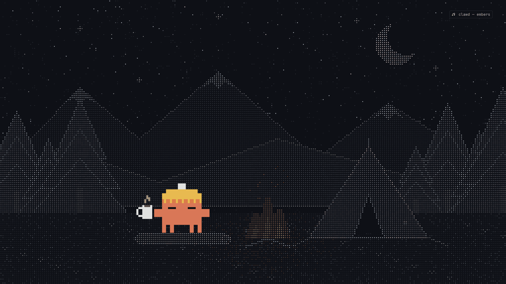</a>

## wallpapers

click a preview for the 4k file.

<table>
<tr>
<td><a href="wallpapers/01-vinyl-3840x2160.png">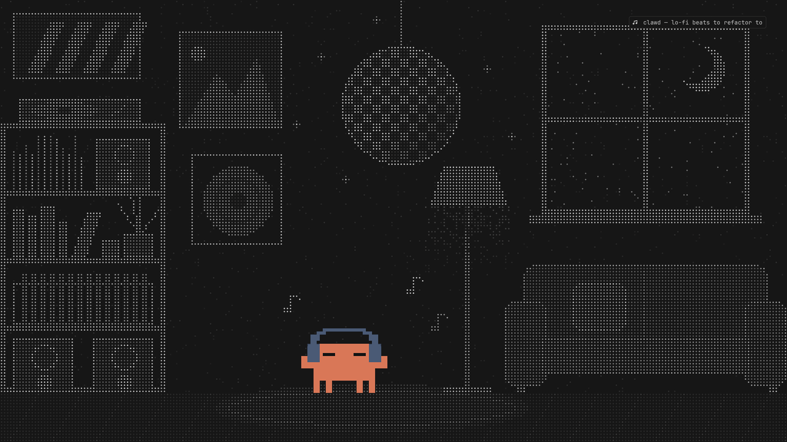</a></td>
<td><a href="wallpapers/02-kitchen-3840x2160.png">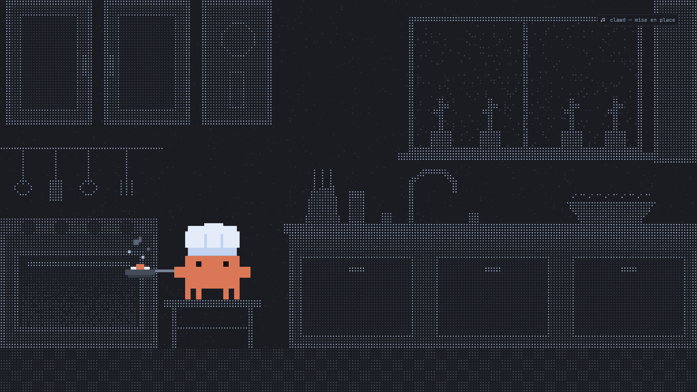</a></td>
</tr>
<tr>
<td><b>01 vinyl</b> · lo-fi beats to refactor to<br><a href="wallpapers/01-vinyl-1920x1080.png">1080p</a> · <a href="wallpapers/01-vinyl-3840x2160.png">4k</a></td>
<td><b>02 kitchen</b> · mise en place<br><a href="wallpapers/02-kitchen-1920x1080.png">1080p</a> · <a href="wallpapers/02-kitchen-3840x2160.png">4k</a></td>
</tr>
<tr>
<td><a href="wallpapers/03-fireplace-3840x2160.png">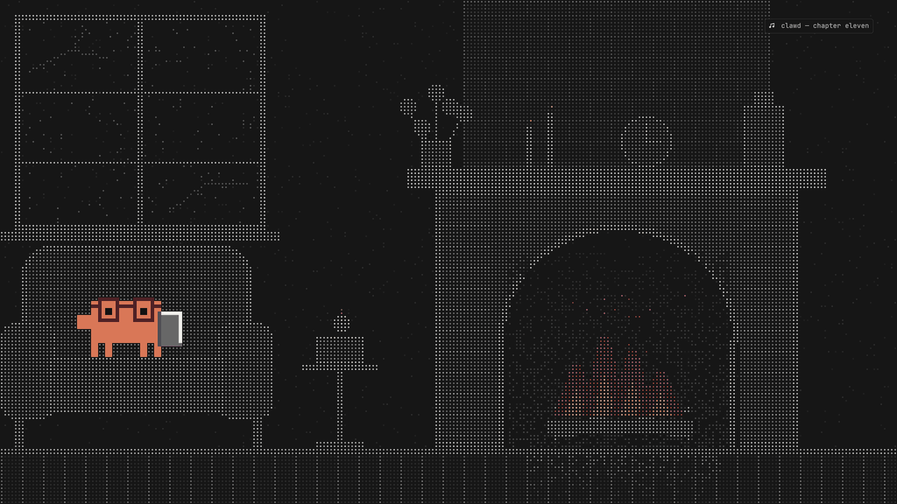</a></td>
<td><a href="wallpapers/04-strawberry-3840x2160.png">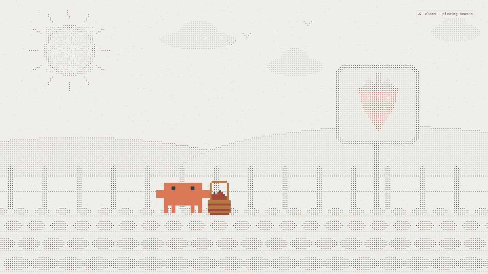</a></td>
</tr>
<tr>
<td><b>03 fireplace</b> · chapter eleven<br><a href="wallpapers/03-fireplace-1920x1080.png">1080p</a> · <a href="wallpapers/03-fireplace-3840x2160.png">4k</a></td>
<td><b>04 strawberry</b> · picking season<br><a href="wallpapers/04-strawberry-1920x1080.png">1080p</a> · <a href="wallpapers/04-strawberry-3840x2160.png">4k</a></td>
</tr>
<tr>
<td><a href="wallpapers/05-desk-3840x2160.png">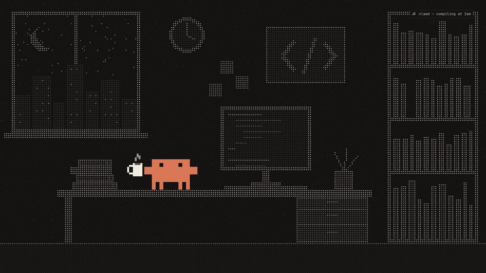</a></td>
<td><a href="wallpapers/06-camp-3840x2160.png"></a></td>
</tr>
<tr>
<td><b>05 desk</b> · compiling at 2am<br><a href="wallpapers/05-desk-1920x1080.png">1080p</a> · <a href="wallpapers/05-desk-3840x2160.png">4k</a></td>
<td><b>06 camp</b> · embers<br><a href="wallpapers/06-camp-1920x1080.png">1080p</a> · <a href="wallpapers/06-camp-3840x2160.png">4k</a></td>
</tr>
<tr>
<td><a href="wallpapers/07-rain-3840x2160.png">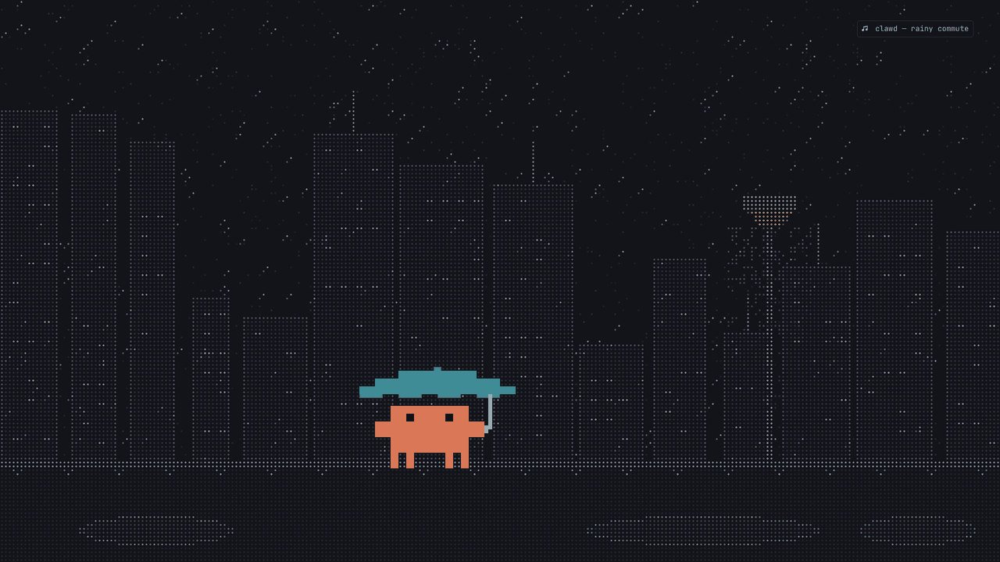</a></td>
<td><a href="wallpapers/08-garden-3840x2160.png">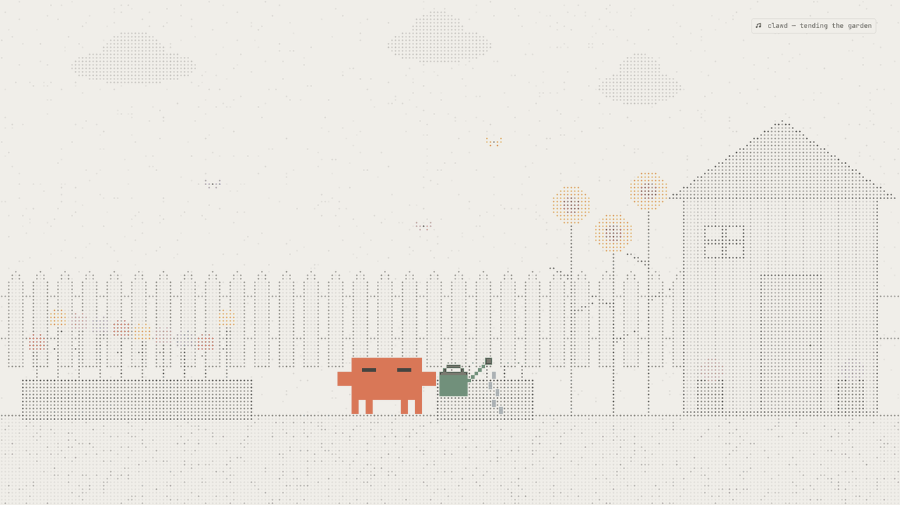</a></td>
</tr>
<tr>
<td><b>07 rain</b> · rainy commute<br><a href="wallpapers/07-rain-1920x1080.png">1080p</a> · <a href="wallpapers/07-rain-3840x2160.png">4k</a></td>
<td><b>08 garden</b> · tending the garden<br><a href="wallpapers/08-garden-1920x1080.png">1080p</a> · <a href="wallpapers/08-garden-3840x2160.png">4k</a></td>
</tr>
<tr>
<td><a href="wallpapers/09-bedroom-3840x2160.png">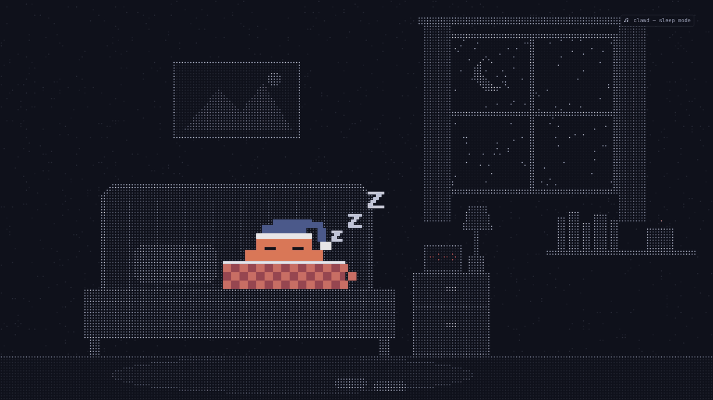</a></td>
<td><a href="wallpapers/10-pier-3840x2160.png">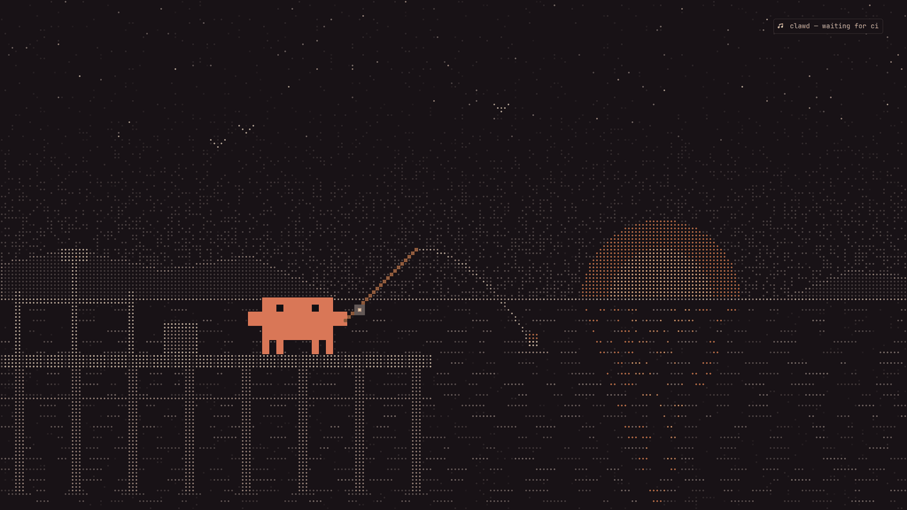</a></td>
</tr>
<tr>
<td><b>09 bedroom</b> · sleep mode<br><a href="wallpapers/09-bedroom-1920x1080.png">1080p</a> · <a href="wallpapers/09-bedroom-3840x2160.png">4k</a></td>
<td><b>10 pier</b> · waiting for ci<br><a href="wallpapers/10-pier-1920x1080.png">1080p</a> · <a href="wallpapers/10-pier-3840x2160.png">4k</a></td>
</tr>
<tr>
<td><a href="wallpapers/11-studio-3840x2160.png">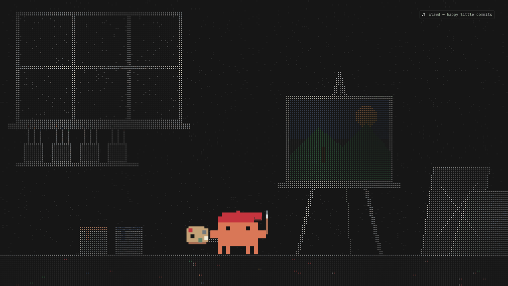</a></td>
<td><a href="wallpapers/12-snow-3840x2160.png">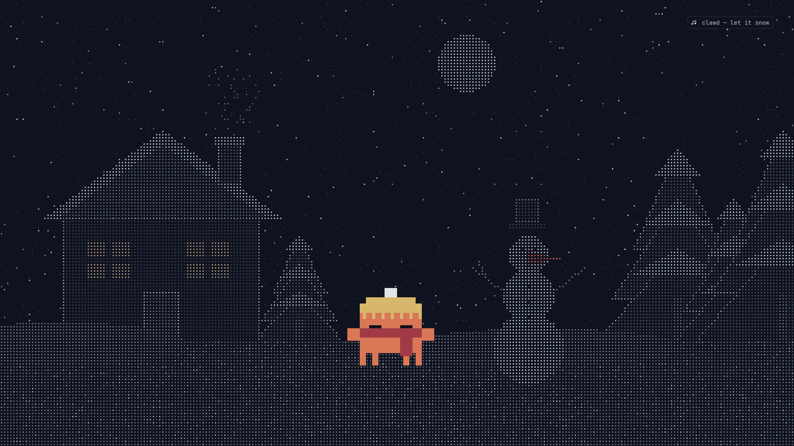</a></td>
</tr>
<tr>
<td><b>11 studio</b> · happy little commits<br><a href="wallpapers/11-studio-1920x1080.png">1080p</a> · <a href="wallpapers/11-studio-3840x2160.png">4k</a></td>
<td><b>12 snow</b> · let it snow<br><a href="wallpapers/12-snow-1920x1080.png">1080p</a> · <a href="wallpapers/12-snow-3840x2160.png">4k</a></td>
</tr>
<tr>
<td><a href="wallpapers/13-moon-3840x2160.png">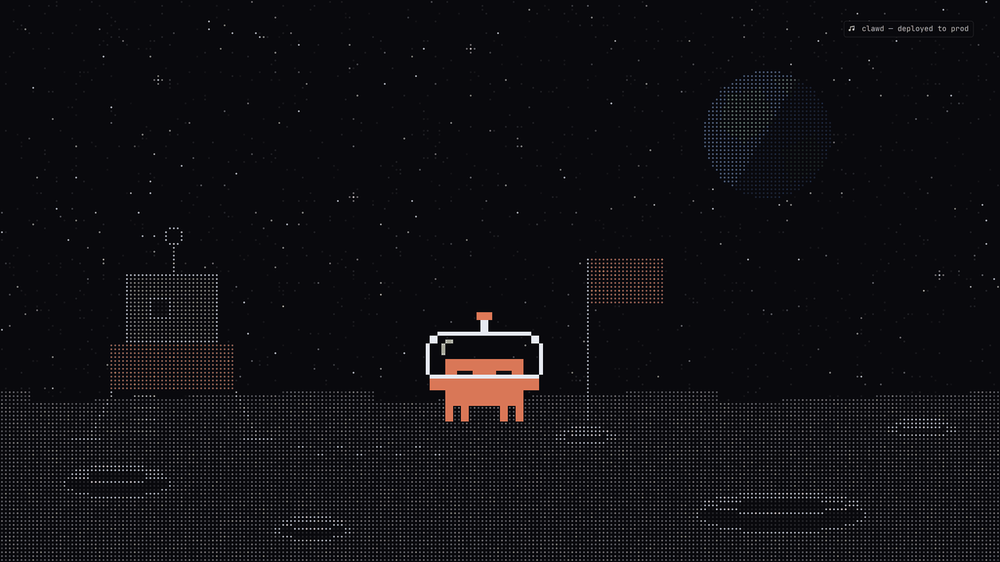</a></td>
<td><a href="wallpapers/14-gaming-3840x2160.png">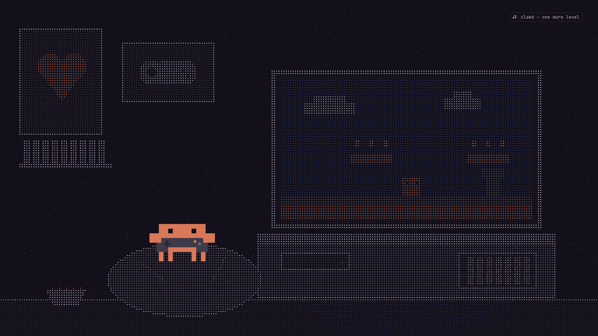</a></td>
</tr>
<tr>
<td><b>13 moon</b> · deployed to prod<br><a href="wallpapers/13-moon-1920x1080.png">1080p</a> · <a href="wallpapers/13-moon-3840x2160.png">4k</a></td>
<td><b>14 gaming</b> · one more level<br><a href="wallpapers/14-gaming-1920x1080.png">1080p</a> · <a href="wallpapers/14-gaming-3840x2160.png">4k</a></td>
</tr>
</table>

## use

grab a file from [`wallpapers/`](wallpapers), or take them all:

```sh
git clone --depth 1 https://github.com/gloomyweather/clawd-wallpapers
```

on [omarchy](https://omarchy.org):

```sh
omarchy theme bg set wallpapers/06-camp-3840x2160.png
```

or copy files into `~/.config/omarchy/backgrounds/<theme>/` and cycle through them with the background switcher. on anything else, use your usual wallpaper tool.

## generate

```sh
pip install -r requirements.txt     # pillow
python gen.py                       # every scene into ./wallpapers
python gen.py out moon camp         # only these scenes, into ./out
```

scenes live on a 256×144 grid. each cell becomes one dot whose brightness is the cell value; some cells carry a tint. the master is rendered at 7680×4320 and downsampled to 4k and 1080p. a scene is a `scene_*()` function in `gen.py` that returns the grid and a few options (where clawd stands, his eyes, what he holds), registered in `SCENES`.

the label in the corner uses a nerd font for its note glyph. set `CLAWD_FONT=/path/to/font.ttf` to pick one. without a nerd font the label is drawn in a plain font, without the glyph.

## about

clawd is the mascot of claude code, made by anthropic. this is unofficial fan art, not affiliated with or endorsed by anthropic.

## license

[mit](LICENSE). clawd himself belongs to anthropic.
